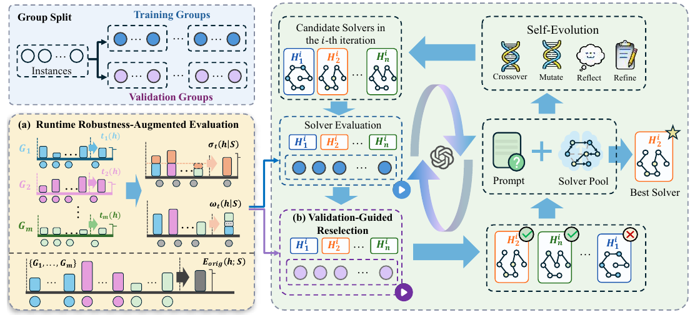

# ERDR — ICDE 2027 Submission

Code and data accompanying the ICDE 2027 submission **Accelerating Dynamic Route Re-solving via Robust Solver Evolution in Automatic Heuristic Design**.

Multi-goal route planning uses spatial data on service locations and pairwise travel costs to determine a visiting order that minimizes total travel cost. The paper studies the re-solving inefficiency of solvers generated by large language model-based automatic heuristic design (AHD) when location changes, new requests, or request cancellations alter the remaining routing problem during execution.

ERDR is a plug-and-play framework that guides AHD evolution toward solvers that re-solve dynamically changed instances faster. Validation-guided reselection reevaluates candidates on instances excluded from routine evolution. Runtime robustness-augmented evaluation supplements the original evaluation objective with inter-group variability and tail risk in solving time.

This repository provides guided local search (GLS)-based baseline and ERDR workflows for EoH, ReEvo, Hercules, and MEoH, together with data-generation and dynamic-evaluation scripts.



*Figure 1. ERDR framework.*

## Requirements

Use the Python environment required by the selected AHD backbone. The four baseline directories retain their own implementation dependencies. Their dependency declarations are not yet consolidated into a tested installation recipe. LLM credential fields in the released configurations are intentionally empty; before solver evolution, provide the endpoint, credential, and model for the selected provider in the `llm` section of `baseline.yaml` or `erdr.yaml`.

## Datasets

The default workflow uses the bundled **TSP200 with 50 instances**, together with Concorde reference solutions. The generation scripts support sizes 50, 100, 200, 500, and 1000. Additional scales must be generated or supplied separately:

```text
data_generate/TSP200_u50/
├── TSP*_u50_concorde.pkl
└── TSP*_u50_concorde_full.json
```

The bundled TSP200 dataset is referenced by the default training and dynamic-evaluation configurations. To regenerate a dataset and its reference solutions, run the following command from `ERDR/` after updating `data_generate/build_tsp_dataset.yaml`:

```bash
python data_generate/generate_uniform_tsp_batches.py --config data_generate/build_tsp_dataset.yaml
```

Dataset regeneration requires a working Concorde executable. Set `concorde.concorde_exe` in `data_generate/build_tsp_dataset.yaml` to the executable path available on the local machine before running the command.

The main dataset-generation parameters are `generation.sizes`, `generation.n_instances`, `generation.seed`, and `concorde.concorde_exe`.

## File Structure

```text
ERDR/
├── README.md
├── assets/
│   └── erdr_framework.png          # ERDR framework illustration
├── data_generate/                  # TSP data and data-generation scripts
│   ├── build_tsp_dataset.yaml
│   └── generate_uniform_tsp_batches.py
└── erdr/                           # Four AHD comparison methods
    ├── EoH-tsp/                    # EoH baseline and EoH + ERDR
    ├── reevo-tsp/                  # ReEvo baseline and ReEvo + ERDR
    ├── Hercules-tsp/               # Hercules baseline and Hercules + ERDR
    └── MEOH-tsp/                   # MEoH baseline and MEoH + ERDR
```

For every baseline, `configs/` contains the experiment settings and `scripts/` contains the three entry points:

- `run_baseline.py` runs the original AHD backbone on static TSP.
- `run_erdr.py` runs the same backbone with ERDR.
- `run_dynamic_evaluation.py` evaluates an evolved solver after dynamic changes.

## Running Commands

Run commands from the `ERDR/` directory. The following example uses EoH; replace `EoH-tsp` with `reevo-tsp`, `Hercules-tsp`, or `MEOH-tsp` as needed.

### 1. Static TSP Baseline

```bash
python erdr/EoH-tsp/scripts/run_baseline.py --config erdr/EoH-tsp/configs/baseline.yaml
```

The evolved solver is saved under the `paths.output_dir` specified in `configs/baseline.yaml`.

### 2. ERDR

```bash
python erdr/EoH-tsp/scripts/run_erdr.py --config erdr/EoH-tsp/configs/erdr.yaml
```

The ERDR solver is saved under the `paths.output_dir` specified in `configs/erdr.yaml`.

### 3. Dynamic TSP Re-solving Evaluation

Run the dynamic evaluation after generating the corresponding baseline or ERDR solver:

```bash
python erdr/EoH-tsp/scripts/run_dynamic_evaluation.py --config erdr/EoH-tsp/configs/dynamic_evaluation.yaml --method erdr
```

The paper evaluates location changes, request arrivals, and request cancellations at 20%, 50%, and 80% tour progress. The following command evaluates all three settings on 50 instances:

```bash
python erdr/EoH-tsp/scripts/run_dynamic_evaluation.py --config erdr/EoH-tsp/configs/dynamic_evaluation.yaml --method erdr --n-instance 50 --ratio-sets "0.2,0.5,0.8" --change-types "location_change,request_arrival,request_cancellation"
```

Use `--method baseline` to evaluate the solver produced by `run_baseline.py`. Replace `EoH-tsp` with `reevo-tsp`, `Hercules-tsp`, or `MEOH-tsp` to run the corresponding backbone.

The top-level baseline and ERDR configs now specify `gpt-6-luna`, matching the current manuscript. Configure a compatible provider endpoint and API credential before running evolution. Provider connectivity and experiment reproduction have not been tested in this preparation step. Training must use actual LLM API calls.

## Important Parameters

| File | Parameters | Description |
| --- | --- | --- |
| `configs/baseline.yaml` | `llm.llm_api_endpoint`, `llm.llm_api_key`, `llm.llm_model` | LLM service used for solver evolution. |
| `configs/baseline.yaml` | `paths.train_pkl`, `paths.output_dir` | Static TSP input and baseline output directory. |
| `configs/erdr.yaml` | `paths.train_pkl`, `paths.output_dir` | Static TSP input and ERDR output directory. |
| `configs/erdr.yaml` | `evaluation.grouped_evaluation` or `evaluation.erdr` | Training/validation grouping and ERDR reselection settings. |
| `configs/dynamic_evaluation.yaml` | `paths.baseline_solver`, `paths.erdr_solver`, `paths.base_pkl` | Solver artifacts and original TSP instances for dynamic evaluation. |
| `configs/dynamic_evaluation.yaml` | `dynamic_evaluation.method`, `change_types`, `ratio_sets`, `n_instance` | Solver variant and dynamic evaluation protocol. |
| `configs/dynamic_evaluation.yaml` | `gls.time_limit_per_instance`, `gls.ite_max` or `gls.iter_limit`, `gls.perturbation_moves` | Re-solving budget and GLS settings. |

The method-specific evolution settings are stored in the `eoh`, `reevo`, `hercules`, or `meoh` section of the selected YAML file. These settings control the population, evolutionary budget, and mutation or operator configuration without changing the command interface.
